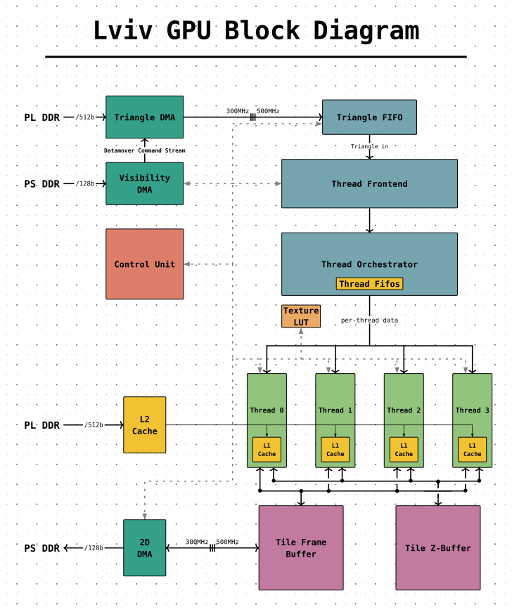

# LVIV GPU

A work-in-progress FPGA GPU in SystemVerilog, with a C++ reference rasterizer.

## Block Diagram

## Layout

| Directory | Contents |
| --- | --- |
| `rtl/` | Hardware and generated pipelines |
| `scripts/` | Pipeline generators and Vivado scripts |
| `tb/` | Testbenches |
| `dv/raster_sw/` | C++ reference and CSV vectors |
| `docs/` | Design notes and diagrams |

