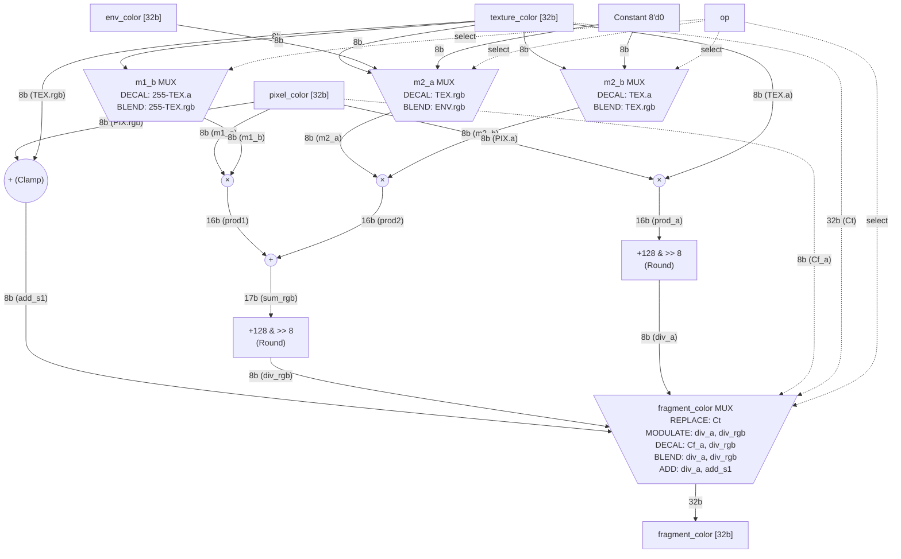

# Fragment Shader Pipeline Architecture

Here is the detailed visual representation of the datapath. It includes the exact RTL register names (in parentheses), explicit bit widths for each bus, constant inputs, and explicitly defines the routing conditions inside every MUX.

